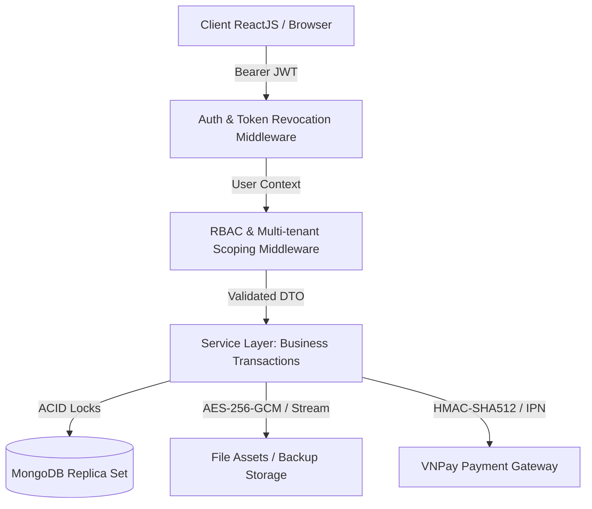

# CẨM NANG VẤN ĐÁP BẢO VỆ ĐỒ ÁN CHUYÊN NGÀNH (DEFENSE Q&A HANDBOOK)
**Dự án:** Hệ thống Quản trị & Kết nối Trường học Đa trường (EduMoet Multi-tenant School Management Platform)  
**Quy chuẩn áp dụng:** [Rubric_Do_An_Mon_Hoc_CNPM_sinhvien_2.docx](../../Rubric_Do_An_Mon_Hoc_CNPM_sinhvien_2.docx) — Mục 6 (Tiêu chí V1 - V4)  
**Cảnh báo Rubric:** *Hội đồng chấm sẽ bốc ngẫu nhiên 5 đoạn code/tài liệu bất kỳ. Sinh viên không trả lời được từ 2/5 đoạn trở lên sẽ bị 0 điểm toàn bộ đồ án do nghi vấn sao chép.*

---

## KHUNG 4 CÂU HỎI VẤN ĐÁP CHUẨN (MỤC 6 RUBRIC)

Khi Hội đồng chỉ vào một đoạn code hoặc hàm bất kỳ, sinh viên cần trả lời theo cấu trúc 4 bước sau:
1. **[V1] Đoạn code này làm gì?** (Nêu ngắn gọn bản chất kỹ thuật và ý nghĩa nghiệp vụ thực tế).
2. **[V2] Tại sao đoạn code này nằm ở đây?** (Giải thích vị trí trong kiến trúc phân tầng; nếu xóa hoặc bỏ qua đoạn này thì điều gì sẽ hỏng hoặc lỗ hổng nào sẽ phát sinh).
3. **[V3] Các tham số / biến số / dữ liệu đầu vào lấy từ đâu?** (Chỉ rõ vòng đời request: Client HTTP -> JWT Token claim -> Middleware injection -> Controller DTO -> Service -> DB Query).
4. **[V4] Nếu sửa đổi logic/kiểu dữ liệu này thì những phần nào khác trong hệ thống bị ảnh hưởng?** (Phân tích tác động lan truyền - Impact analysis: database schema, API contracts, các module liên quan, giao diện React).

---

## 10 MODULE KỸ THUẬT NÒNG CỐT HAY BỊ HỎI NHẤT

---

### MODULE 1: Phân quyền Động RBAC & Permission Matrix (`rbac.middleware.js`)
**Vị trí file:** `ExpressJS/src/middleware/common/security/rbac.middleware.js`

- **[V1] Đoạn code này làm gì?**
  Kiểm tra quyền hạn của người dùng đối với một tài nguyên (`resource`) và hành động (`action`) cụ thể dựa trên ma trận quyền linh hoạt (Role-Based Access Control) kết hợp kiểm tra quyền sở hữu dữ liệu (`own_data`).
- **[V2] Tại sao nằm ở đây? Nếu bỏ đi thì sao?**
  Nằm ở tầng middleware của Express pipeline ngay sau `authenticate`. Nếu bỏ middleware này, bất kỳ ai có token hợp lệ (ví dụ học sinh, phụ huynh) đều có thể gọi trực tiếp API của Admin (như sửa điểm, duyệt giáo án, xóa tài khoản, phân công giảng dạy) dẫn đến lỗ hổng IDOR (Insecure Direct Object References) và leo thang đặc quyền.
- **[V3] Dữ liệu đầu vào lấy từ đâu?**
  - `req.user`: Được middleware `authenticate` gắn vào sau khi giải mã Access Token JWT và truy vấn thông tin User + Role trong DB.
  - `resource` và `action`: Được khai báo cứng tại từng định nghĩa Route (ví dụ: `authorize('grades', 'create')`).
  - Ma trận quyền: Nằm trong bảng `Role` và `role.permissions` lưu trong database MongoDB.
- **[V4] Tác động khi thay đổi:**
  Nếu đổi tên quyền (ví dụ `grades:update` thành `grades:edit`), tất cả các route khai báo `authorize('grades', 'update')`, các hàm helper `can(user, ...)` trên frontend ReactJS, và bảng ánh xạ catalog quyền `role.constant.js` đều sẽ bị từ chối truy cập (lỗi 403 Forbidden).

---

### MODULE 2: Cô lập Dữ liệu Đa trường (Multi-tenancy Scoping - `write-scope.service.js`)
**Vị trí file:** `ExpressJS/src/services/common/access-control/write-scope.service.js`

- **[V1] Đoạn code này làm gì?**
  Đảm bảo mọi thao tác ghi/đọc dữ liệu (học sinh, lớp học, giáo án, điểm số, học phí) đều bị khóa chặt trong phạm vi Trường (`schoolId`) hoặc Cụm trường (`clusterId`) mà người dùng trực thuộc.
- **[V2] Tại sao nằm ở đây? Nếu bỏ đi thì sao?**
  Nằm ở tầng Access Control Service trước khi gọi DB Query. Nếu xóa đi, Admin trường A có thể xem trộm hoặc sửa đổi dữ liệu điểm danh, học bạ, tài chính của trường B chỉ bằng cách truyền `schoolId` hoặc `classId` khác vào URL parameter, làm phá vỡ mô hình kiến trúc SaaS Đa trường (Multi-tenant).
- **[V3] Dữ liệu đầu vào lấy từ đâu?**
  - `actor.schoolId` và `actor.clusterId`: Trích xuất từ tài khoản đã được xác thực (`req.user`).
  - `targetSchoolId`: Lấy từ route params hoặc body request.
- **[V4] Tác động khi thay đổi:**
  Nếu nới lỏng logic so khớp `schoolId`, nguy cơ rò rỉ dữ liệu giữa các trường. Nếu siết quá chặt mà không xử lý ngoại lệ cho `SUPER_ADMIN` hoặc `CLUSTER_ADMIN`, các tài khoản quản trị cấp Sở/Cụm sẽ bị chặn không xem được báo cáo tổng hợp liên trường.

---

### MODULE 3: Thu hồi Phiên & Vòng đời Token JWT (`auth.middleware.js` & `auth.service.js`)
**Vị trí file:** `ExpressJS/src/middleware/common/security/auth.middleware.js`

- **[V1] Đoạn code này làm gì?**
  Xác thực tính toàn vẹn của Access Token JWT, kiểm tra `tokenVersion` / `passwordChangedAt` và danh sách đen JWT (revocation list). Nếu người dùng đã đổi mật khẩu, đăng xuất từ xa hoặc bị Admin khóa tài khoản, token cũ dù chưa hết hạn 15 phút vẫn bị từ chối ngay lập tức (trả về 401 Unauthorized).
- **[V2] Tại sao nằm ở đây? Nếu bỏ đi thì sao?**
  Nằm ở đầu chuỗi middleware của toàn bộ ứng dụng. Nếu chỉ kiểm tra chữ ký JWT thông thường mà không kiểm tra trạng thái thu hồi phiên, kẻ tấn công khi đánh cắp được token vẫn có thể tiếp tục truy cập trái phép dù nạn nhân đã phát hiện và đổi mật khẩu.
- **[V3] Dữ liệu đầu vào lấy từ đâu?**
  - `Bearer Token`: Lấy từ HTTP header `Authorization`.
  - Bí mật giải mã: Biến môi trường `JWT_SECRET`.
  - Phiên bản xác thực: Trường `tokenVersion` trên model `User` trong MongoDB.
- **[V4] Tác động khi thay đổi:**
  Nếu thay đổi cấu trúc payload của JWT (ví dụ đổi tên claim `userId` thành `id`), mọi middleware kiểm tra `req.user.id`, các service tra cứu audit trail và token refresh flow sẽ ném ngoại lệ `null pointer`.

---

### MODULE 4: Giao dịch Chuyển lớp & Bảo toàn Điểm (`academic.service.js`)
**Vị trí file:** `ExpressJS/src/services/admin/academic.service.js`

- **[V1] Đoạn code này làm gì?**
  Thực hiện chuyển lớp cho học sinh giữa kỳ: bảo toàn điểm số học kỳ cũ, bàn giao điểm sang lớp mới, cập nhật sĩ số 2 lớp, và ghi nhật ký lịch sử chuyển lớp trong một MongoDB Session Transaction có khóa độc quyền.
- **[V2] Tại sao nằm ở đây? Nếu bỏ đi thì sao?**
  Nằm trong Service xử lý học thuật. Việc dùng Transaction ACID đảm bảo nếu việc cập nhật lớp đích hoặc bàn giao điểm môn học bị lỗi ở giữa chừng, toàn bộ thay đổi sẽ được Rollback hoàn toàn. Nếu không dùng transaction, học sinh có thể bị xóa khỏi lớp cũ nhưng chưa vào được lớp mới, dẫn đến mất trắng toàn bộ dữ liệu điểm số.
- **[V3] Dữ liệu đầu vào lấy từ đâu?**
  - `studentId`, `targetClassId`, `effectiveSemester`, `reason`: Nhận từ Client qua `transferStudent` API.
  - Snapshot điểm hiện tại: Truy vấn từ collection `Grade`.
- **[V4] Tác động khi thay đổi:**
  Chức năng này tác động trực tiếp đến bảng `Class` (sĩ số), bảng `StudentClassHistory`, bảng `Grade` (cập nhật `classId`), và các báo cáo điểm GPA lớp của cả giáo viên chủ nhiệm cũ lẫn mới.

---

### MODULE 5: CLI Sao lưu & Phục hồi Mã hóa AES-256 (`backup-restore.service.js`)
**Vị trí file:** `ExpressJS/src/services/common/platform/backup-restore.service.js` & `ExpressJS/bin/backup-restore.js`

- **[V1] Đoạn code này làm gì?**
  Cung cấp công cụ dòng lệnh (CLI) độc lập để xuất toàn bộ cơ sở dữ liệu MongoDB + kho tài liệu FileAsset thành gói nén `.tar.gz`, sau đó mã hóa đối xứng bằng thuật toán `AES-256-GCM` kèm checksum SHA-256 để chống can thiệp dữ liệu khi sao lưu.
- **[V2] Tại sao nằm ở đây? Nếu bỏ đi thì sao?**
  Là công cụ Disaster Recovery cấp hệ thống (vận hành qua CLI độc lập với web server). Nếu bỏ kiểm tra checksum hoặc GCM auth tag, hệ thống có thể giải mã và nạp vào DB một file backup đã bị kẻ xấu chỉnh sửa hoặc tiêm mã độc (tampering).
- **[V3] Dữ liệu đầu vào lấy từ đâu?**
  - Khóa mã hóa `BACKUP_ENCRYPTION_KEY`: Đọc từ biến môi trường của hệ điều hành máy chủ.
  - Dữ liệu nguồn: Dump trực tiếp từ MongoDB ReplSet và thư mục storage files.
- **[V4] Tác động khi thay đổi:**
  Nếu đổi thuật toán từ GCM sang CBC hoặc đổi Salt derivation, các tệp backup đã tạo trước đó sẽ không thể giải mã và phục hồi lại được.

---

### MODULE 6: Vòng đời Đề thi Trực tuyến & Tự động Thu bài (`exam.service.js`)
**Vị trí file:** `ExpressJS/src/services/common/academics/exam.service.js`

- **[V1] Đoạn code này làm gì?**
  Quản lý vòng đời lượt thi (`ExamAttempt`): Đếm ngược thời gian làm bài, xáo trộn câu hỏi ngẫu nhiên theo từng học sinh để chống gian lận, tự động lưu bản nháp từng câu qua cơ chế Debounce, và bắt buộc Server-side Timeout (tự chốt bài khi hết giờ kể cả khi học sinh cố tình ngắt mạng).
- **[V2] Tại sao nằm ở đây? Nếu bỏ đi thì sao?**
  Nằm ở tầng Service nghiệp vụ thi cử. Nếu chỉ kiểm tra thời gian làm bài ở phía trình duyệt React (Client-side), học sinh có thể dùng DevTools hoặc chỉnh giờ đồng hồ máy tính để làm bài vô thời hạn. Việc chốt hạn ở Server là nguyên tắc bắt buộc để đảm bảo công bằng.
- **[V3] Dữ liệu đầu vào lấy từ đâu?**
  - `startedAt` và `durationMinutes`: Ghi nhận lúc học sinh bấm bắt đầu làm bài.
  - `deadline = startedAt + durationMinutes + gracePeriod`.
  - Mảng đáp án câu hỏi gửi lên qua REST API `saveAnswerDraft`.
- **[V4] Tác động khi thay đổi:**
  Ảnh hưởng đến điểm số bài thi, trạng thái lượt thi (`SUBMITTED` / `TIMEOUT_SUBMITTED`), và thông báo gửi đến Giáo viên bộ môn.

---

### MODULE 7: Tích hợp Cổng thanh toán VNPay & Xử lý IPN Idempotent (`vnpay.service.js`)
**Vị trí file:** `ExpressJS/src/services/common/payments/vnpay.service.js`

- **[V1] Đoạn code này làm gì?**
  Tạo URL thanh toán có chữ ký HMAC-SHA512 gửi sang VNPay, đồng thời xử lý webhook gọi lại (IPN - Instant Payment Notification) để cập nhật trạng thái hóa đơn học phí từ `UNPAID` sang `PAID` một cách an toàn và chống lặp (Idempotent).
- **[V2] Tại sao nằm ở đây? Nếu bỏ đi thì sao?**
  Nằm trong phân hệ Payment. Nếu không xác thực chữ ký số `vnp_SecureHash` trong callback, kẻ tấn công có thể giả mạo gói tin IPN gửi tới server để đổi trạng thái hóa đơn học phí của con mình thành "Đã đóng" mà không hề chuyển tiền thật.
- **[V3] Dữ liệu đầu vào lấy từ đâu?**
  - `vnp_TmnCode`, `vnp_HashSecret`: Cấu hình sandbox của cổng thanh toán.
  - `invoiceId`, `amount`: Từ bản ghi `Invoice` trong DB.
  - Các tham số URL trả về từ VNPay (`vnp_ResponseCode`, `vnp_TransactionNo`, `vnp_SecureHash`).
- **[V4] Tác động khi thay đổi:**
  Ảnh hưởng đến bảng `Invoice` (số tiền đã thu `paidAmount`, trạng thái `status`), bảng `PaymentTransaction` (lịch sử giao dịch), và thống kê tài chính của Nhà trường.

---

### MODULE 8: Xuất Học bạ PDF & DOCX Chuẩn Bộ GD&ĐT (`student-document.service.js`)
**Vị trí file:** `ExpressJS/src/services/admin/student-document.service.js`

- **[V1] Đoạn code này làm gì?**
  Tạo học bạ điện tử định dạng PDF phân trang chuẩn bằng `PDFKit` nhúng font `Noto Sans Unicode` tiếng Việt và định dạng `.docx` thật chuẩn Microsoft OpenXML, kèm mã hash MD5/SHA và ghi Audit Log lần xuất.
- **[V2] Tại sao nằm ở đây? Nếu bỏ đi thì sao?**
  Nằm ở tầng xử lý tài liệu hành chính. Nếu không nhúng font Noto Sans hỗ trợ đầy đủ Unicode tiếng Việt, file PDF xuất ra sẽ bị lỗi ký tự (toàn bộ dấu tiếng Việt biến thành ô vuông hoặc ký tự lạ). Việc ghi Audit log xuất học bạ đảm bảo việc truy vết ai là người đã trích xuất dữ liệu học bạ của học sinh.
- **[V3] Dữ liệu đầu vào lấy từ đâu?**
  - Thông tin cá nhân học sinh từ bảng `User`.
  - Kết quả học tập từng môn từ bảng `Grade`.
  - Xếp loại hạnh kiểm từ bảng `Conduct`.
  - Khen thưởng / kỷ luật từ bảng `Reward`.
- **[V4] Tác động khi thay đổi:**
  Thay đổi cấu trúc trường điểm (ví dụ thêm điểm Đánh giá rèn luyện) đòi hỏi phải cập nhật lại layout bảng vẽ trong cả template PDF và template XML của file Word.

---

### MODULE 9: Kiểm tra Xung đột Thời khóa biểu & Điểm danh (`timetable.service.js`)
**Vị trí file:** `ExpressJS/src/services/admin/timetable.service.js`

- **[V1] Đoạn code này làm gì?**
  Kiểm tra 3 điều kiện xung đột lịch học khi xếp thời khóa biểu hoặc xin dạy bù: (1) Giáo viên không dạy 2 lớp cùng 1 tiết, (2) Phòng học không chứa 2 lớp cùng 1 thời điểm, (3) Lớp học không học 2 môn cùng 1 tiết.
- **[V2] Tại sao nằm ở đây? Nếu bỏ đi thì sao?**
  Nằm trong Service xếp lịch học thuật. Nếu bỏ thuật toán kiểm tra này, thời khóa biểu sẽ bị trùng tiết (collision), giáo viên bị phân thân dạy 2 lớp cùng lúc, và luồng điểm danh tự động theo tiết sẽ không thể xác định được lớp nào đang học.
- **[V3] Dữ liệu đầu vào lấy từ đâu?**
  - `dayOfWeek`, `period`, `teacherId`, `roomId`, `classId`, `academicYearId`, `semester`.
  - So khớp với các bản ghi đã tồn tại trong collection `Timetable`.
- **[V4] Tác động khi thay đổi:**
  Ảnh hưởng đến bảng `Timetable`, tính năng xem lịch cá nhân của giáo viên/học sinh, và màn hình Điểm danh tự động theo tiết hiện hành.

---

### MODULE 10: Xem trước Tệp an toàn & Quản lý Bộ nhớ Blob (`FilePreviewModal.jsx`)
**Vị trí file:** `ReactJS/src/components/FilePreviewModal.jsx` & `ReactJS/src/utils/file-preview.js`

- **[V1] Đoạn code này làm gì?**
  Cho phép người dùng xem trực tiếp tài liệu PDF (qua iframe), ảnh scan hồ sơ, file văn bản thô ngay trong Modal popup mà không bắt buộc phải tải tệp về máy tính; đồng thời giải phóng bộ nhớ `URL.revokeObjectURL()` khi đóng modal.
- **[V2] Tại sao nằm ở đây? Nếu bỏ đi thì sao?**
  Là một Component UI dùng chung trong React. Nếu không gọi `URL.revokeObjectURL(url)` sau khi đóng modal, mỗi lần xem tài liệu nặng (PDF 20-30MB), bộ nhớ RAM của trình duyệt sẽ bị rò rỉ (memory leak), khiến trình duyệt bị giật lag hoặc crash khi mở nhiều tài liệu.
- **[V3] Dữ liệu đầu vào lấy từ đâu?**
  - Luồng nhị phân (Binary Blob) tải về từ API `/v1/api/files/:id/download` kèm header `Authorization: Bearer <token>`.
  - MIME type được chuẩn hóa bởi hàm `getFileType()` và `getMimeTypeFromFileName()`.
- **[V4] Tác động khi thay đổi:**
  Ảnh hưởng đến trải nghiệm người dùng tại cả 2 trang: Kho học liệu số ([MaterialsPage.jsx](file:///d:/TLCN/TLCN_01_DT/ReactJS/src/features/library/MaterialsPage.jsx)) và Hồ sơ học sinh ([StudentDocumentsPage.jsx](file:///d:/TLCN/TLCN_01_DT/ReactJS/src/features/student-documents/StudentDocumentsPage.jsx)).

---

## BỘ CÂU HỎI NHANH "BẪY" CỦA HỘI ĐỒNG & CÁCH ĐÁP

| Câu hỏi của Thầy/Cô | Cách trả lời "Ăn điểm" |
| :--- | :--- |
| **"Tại sao dự án dùng MongoDB mà không dùng PostgreSQL hay MySQL?"** | "Dạ, hệ thống trường học đa trường cần lưu trữ linh hoạt nhiều đối tượng có cấu trúc biến động: Ma trận điểm số động theo từng môn, câu hỏi đề thi trắc nghiệm kèm nhiều đáp án, các snapshot học bạ lịch sử không cố định trường dữ liệu. MongoDB hỗ trợ Document model rất tốt cho việc này. Đồng thời, đối với các nghiệp vụ nhạy cảm như ghi điểm và chuyển lớp, chúng em sử dụng **MongoDB Replica Set Transaction** để đảm bảo đầy đủ tính chất ACID tương đương RDBMS." |
| **"Hệ thống phân quyền lưu ở đâu, có bị hardcode không?"** | "Dạ hoàn toàn không hardcode. Toàn bộ danh mục quyền (`permissions`) được quản lý động trong collection `Role`. Khi gán quyền cho một Role (ví dụ: Tổ trưởng chuyên môn, Kế toán), hệ thống lưu mảng quyền vào database. Middleware `rbac.middleware.js` kiểm tra quyền theo thời gian thực dựa trên token của người dùng." |
| **"Nếu một giáo viên bị xóa tài khoản thì điểm của học sinh do giáo viên đó chấm có bị xóa không?"** | "Dạ không. Chúng em áp dụng nguyên tắc **Bảo toàn dữ liệu học thuật**: bản ghi điểm số trong bảng `Grade` chỉ lưu ID tham chiếu tới giáo viên chấm lúc đó (`gradedBy`). Việc vô hiệu hóa tài khoản giáo viên chỉ chuyển trạng thái tài khoản sang `INACTIVE` hoặc xóa logic (`soft delete`), toàn bộ dữ liệu điểm số và học bạ của học sinh vẫn được giữ nguyên vẹn để phục vụ thanh tra và lưu trữ quốc gia." |
| **"Tại sao không upload file trực tiếp vào database dưới dạng Base64?"** | "Dạ, lưu nhị phân Base64 vào database sẽ làm phình to dung lượng DB lên ít nhất 33%, gây nghẽn I/O và làm chậm nghiêm trọng các truy vấn nghiệp vụ. Chúng em thiết kế tầng `FileAsset` tách biệt: metadata file lưu trong MongoDB, còn dữ liệu nhị phân của file được stream trực tiếp lên Amazon S3 (production) hoặc Local Isolated Storage (development)." |
